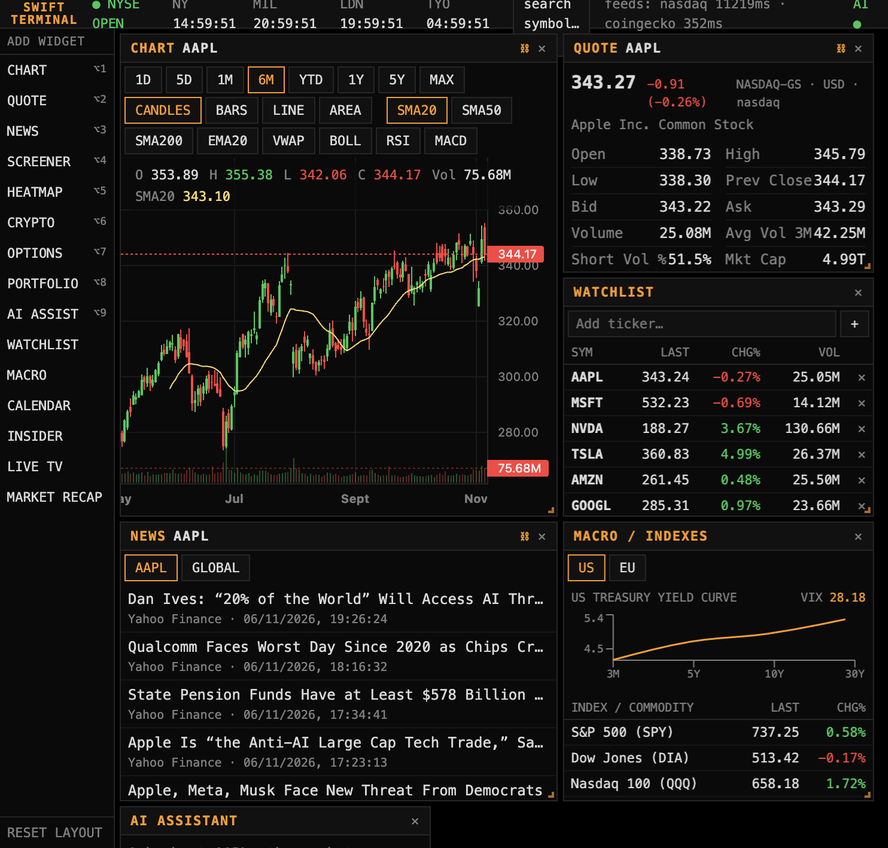
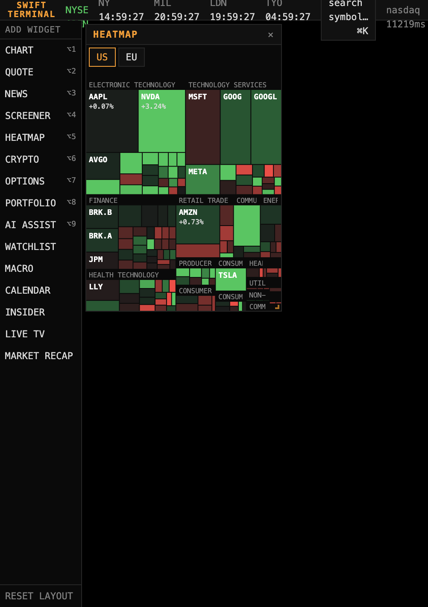
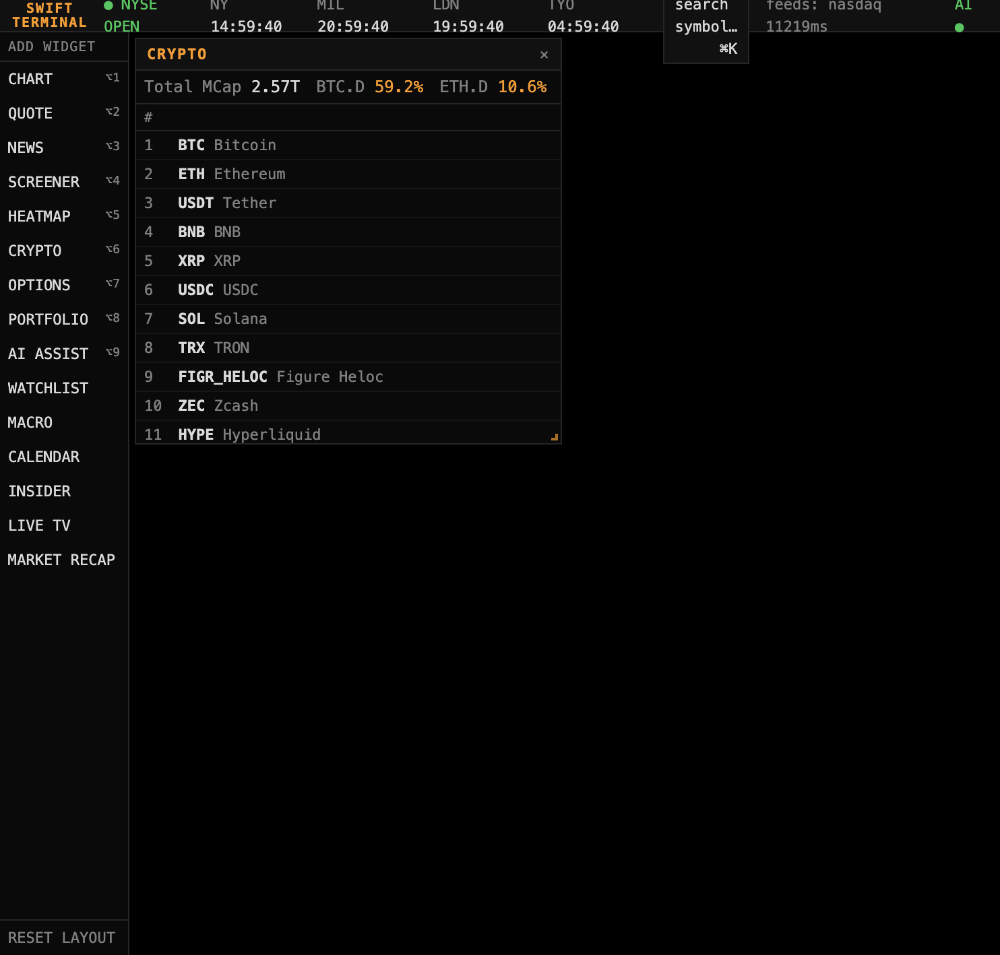

# Swift Terminal

**A fast, keyboard-first, terminal-style trading dashboard — built entirely on free, public market data.**

No subscription. No account. No API keys required.

Next.js · React · TypeScript · Express · SQLite · MIT



## What it is

Swift Terminal is a dense, dark, keyboard-driven workspace for watching markets. It stitches several free, publicly documented (or widely used) market-data endpoints into one fast, widget-based dashboard that runs entirely on your own machine — or your own server.

Every data endpoint sits behind an automatic fallback chain, so a single provider hiccup never takes the whole thing down, and results are cached with a stale-while-revalidate strategy so a temporary outage never blanks the UI.

## Features

- 🖥️ **Widget workspace** — drag, resize, add and remove panels; the layout is saved locally and restored on reload
- ⌘K **command palette** — search stocks, ETFs and crypto and jump straight to them
- 📈 **Professional charting** — candlesticks, bars, line, area, volume, multiple timeframes and SMA / EMA / VWAP / Bollinger Bands / RSI / MACD, with a live hover legend
- 💹 **Quote panel** — last / bid / ask / OHLC, volume, market cap, P/E, EPS, dividend yield, 52-week range, beta, shares outstanding
- 📰 **News feed** — aggregated and de-duplicated from multiple RSS sources, per symbol or global
- 🔎 **Full-market screener** — filter and sort the US equity market
- 🗺️ **Live sector heatmap** — the market as a treemap, sized by market cap and colored by daily change
- ⛓️ **Options chain** — calls and puts with strike, bid/ask, volume, open interest and ITM highlighting
- 🪙 **Crypto board** — top assets with sparklines and full OHLCV charting
- 🏦 **Macro dashboard** — US Treasury yield curve, VIX and major index/commodity proxies
- 💼 **Portfolio tracker** — log transactions, track cost basis and P&L (persisted in SQLite)
- 📅 **Calendar** — economic events and earnings, with history
- 🤖 **AI assistant** (optional) — ask about the symbol you are looking at; context-aware of the terminal's current data, using any OpenAI-compatible endpoint
- ⚡ **Near real-time updates** — quotes and indexes refresh continuously with a subtle flash on change
- ⌨️ **Keyboard shortcuts** everywhere — `⌘K` to search, `⌥1`–`⌥9` to add widgets

## Screenshots

| Live sector heatmap | Crypto board |
| --- | --- |
|  |  |

## Quick start

```sh
git clone https://github.com/JaeSwiftxyz/swift-terminal.git
cd swift-terminal
cp .env.example .env   # optional — needed only for the AI assistant
docker compose up --build
```

- Web UI → **http://localhost:3000/tools/terminal/**
- API health → **http://localhost:4000/api/status**

A `.env` file is not required to get a fully working terminal.

### AI assistant (optional)

The assistant speaks to any **OpenAI-compatible** chat endpoint. Example for Venice:

```sh
# .env
LLM_API_URL=https://api.venice.ai/api/v1
LLM_API_KEY=your-key-here
LLM_MODEL=claude-haiku-5-5
```

Without a key the assistant politely reports itself unavailable; everything else keeps working.

### Configuration

| Variable | Purpose |
| --- | --- |
| `API_KEY` | Shared secret between web and api. Auto-generated on first run if unset. |
| `WEB_ORIGIN` | Browser origin allowed to call the API directly. |
| `TRUST_PROXY` | Set to `1` when exactly one trusted reverse proxy sets `X-Forwarded-For`. |
| `LLM_API_URL` / `LLM_API_KEY` / `LLM_MODEL` | Optional AI assistant (OpenAI-compatible). |

By default the UI is served under the path `/tools/terminal` (matching the deployment it was built for), so the bare host root 404s by design. To serve at the domain root, change `basePath` in `web/next.config.ts` and the fetch prefix in `web/lib/api.ts`, then rebuild.

## How it works

- **web** (Next.js) and **api** (Express + SQLite) run as two containers. The browser only ever talks to the web app; the web app proxies every API call server-side and attaches the shared `API_KEY`, so the secret never reaches the browser.
- **Providers** each live in `server/src/providers/` as a small isolated module and fall back to alternatives on failure; a TTL cache with stale-while-revalidate keeps the UI smooth through provider hiccups.
- **Portfolio data** persists in a named Docker volume (SQLite, WAL mode).

## Data sources

| Data | Primary source | Fallback |
| --- | --- | --- |
| Quotes (stocks/ETFs) | Nasdaq public quote API | Yahoo Finance → Stooq |
| Fundamentals | TradingView scanner API | — |
| Historical candles | Nasdaq chart API (daily) · Yahoo Finance (intraday 1D/5D) | Stooq |
| Symbol search | TradingView + built-in crypto tickers | Yahoo Finance |
| Screener / heatmap | TradingView scanner API | — |
| Options chain | Nasdaq | Yahoo Finance |
| News | Yahoo Finance RSS | Google News RSS |
| Crypto quotes | Binance public API | Coinbase → Kraken |
| Crypto board | CoinGecko | Binance public API |
| Crypto candles / orderbook | Binance public API | — |
| Macro | FRED | — |
| Calendar | Forex Factory | FRED (actuals) |

> These are public endpoints, not licensed data feeds — treat prices as delayed/indicative, not execution-grade.

## Security

- No secrets in the repository — everything sensitive lives in `.env` (gitignored).
- The API binds to `127.0.0.1` and only accepts browser requests from `WEB_ORIGIN` by default.
- The portfolio and AI endpoints require the shared secret; the bundled web proxy supplies it automatically.

## Disclaimer

For personal and educational use only. Market data may be delayed, incomplete or occasionally wrong — do not use it for real investment decisions.

## License

[MIT](LICENSE)
